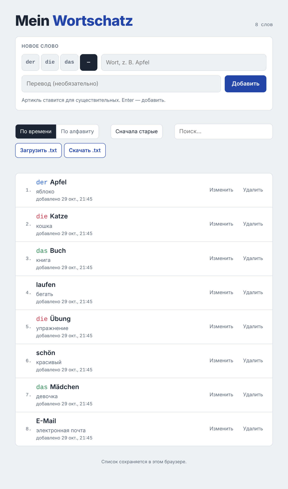

# Mein Wortschatz

Мини-приложение для личного словаря немецких слов. Записываешь слово с артиклем и переводом, а оно хранит список, нумерует его, сортирует и даёт выгрузить в текстовый файл.

Всё приложение — один HTML-файл без сборки и зависимостей. Его можно открыть двойным кликом.



## Возможности

- **Добавление слов:** артикль `der` / `die` / `das` (или без артикля для глаголов, прилагательных и т. д.), слово и перевод (необязательно). Слово добавляется по Enter.
- **Проверка на повторы:** если слово уже есть в списке, появится предупреждение. Регистр не учитывается.
- **Нумерация** по текущей сортировке.
- **Редактирование:** можно поправить артикль, слово и перевод. Enter сохраняет, Esc отменяет.
- **Удаление** с подтверждением «Да / Нет».
- **Сортировка:**
  - по времени добавления: сначала старые или сначала новые;
  - по алфавиту: A → Z или Z → A. Сравнение по правилам немецкого языка, поэтому `Ä`, `Ö`, `Ü` стоят рядом с `A`, `O`, `U`.
- **Поиск** по слову или переводу. Номера слов при поиске сохраняются.
- **Скачивание списка в `.txt`** в текущей сортировке.
- **Загрузка списка из `.txt`:** добавить только новые слова или заменить весь список.
- **Светлая и тёмная тема:** переключатель «Светлая / Тёмная / Авто» в шапке. В режиме «Авто» тема следует за настройками системы. Выбор запоминается.
- **Мобильная вёрстка:** интерфейс работает и на узком экране телефона.

## Запуск

### Локально

1. Скачайте `wortschatz.html` (кнопка **Code → Download ZIP** или просто сам файл).
2. Откройте его в браузере двойным кликом.

Сервер и установка не нужны. Интернет используется только для загрузки шрифтов из Google Fonts. Без сети приложение работает так же, только со системными шрифтами.

### Через GitHub Pages

1. В репозитории откройте **Settings → Pages**.
2. В разделе **Build and deployment** выберите **Deploy from a branch**, ветку `main` и папку `/ (root)`.
3. Через минуту-две приложение будет доступно по адресу:
   `https://defteespero.github.io/Wortschatz/wortschatz.html`

Если переименовать файл в `index.html`, адрес станет короче: `https://defteespero.github.io/Wortschatz/`.

> **Важно:** у версии на GitHub Pages и у локального файла **разные списки слов** (подробнее в разделе «Где хранятся слова»). Чтобы перенести слова, скачайте `.txt` в одной версии и загрузите его в другой.

## Как пользоваться

| Действие | Как сделать |
|---|---|
| Добавить слово | Выберите артикль (или «—»), введите слово и при желании перевод, нажмите **Добавить** или Enter |
| Исправить слово | **Изменить** → правка → Enter или **Сохранить** (Esc — отмена) |
| Удалить слово | **Удалить** → **Да** |
| Поменять сортировку | **По времени** / **По алфавиту**, кнопка рядом меняет направление |
| Найти слово | Начните вводить в поле **Поиск…** — по-немецки или по-русски |
| Сменить тему | **Светлая** / **Тёмная** / **Авто** в правом верхнем углу |
| Сохранить список в файл | **Скачать .txt** |
| Загрузить список из файла | **Загрузить .txt** → выберите файл → **Добавить новые** или **Заменить весь список** |

## Формат `.txt`

### Скачивание

Кнопка **Скачать .txt** сохраняет файл `wortschatz-ГГГГ-ММ-ДД.txt`:

```text
Mein Wortschatz — 4 слова
Сортировка: по алфавиту (A → Z)
Дата: 29.10.2026

1. der Apfel — яблоко
2. das Buch
3. laufen — бегать
4. die Übung — упражнение
```

В файл попадает весь список, даже если в поиске что-то введено. Файл сохраняется в кодировке UTF-8 с BOM и с переводами строк Windows (`CRLF`), поэтому умлауты и кириллица правильно открываются и в Блокноте Windows.

### Загрузка

Приложение понимает свои собственные выгрузки и списки, написанные вручную: **одно слово на строку**.

```text
der Apfel — яблоко
Das Haus - дом
laufen	бегать
Schule = школа
die Katze
1. das Buch — книга
10) E-Mail — электронная почта
```

Правила разбора:

- Пустые строки и шапка выгрузки (`Mein Wortschatz…`, `Сортировка:`, `Дата:`) пропускаются.
- Нумерация в начале строки (`1.`, `10)`) отбрасывается.
- Слово и перевод разделяются тире `—`, `–`, `-` или знаком `=` **с пробелами вокруг**, либо табуляцией. Поэтому слова с дефисом, например `E-Mail`, не разрываются.
- Артикль `der` / `die` / `das` в начале распознаётся автоматически, в том числе с большой буквы.
- Повторы внутри файла и слова, которые уже есть в списке, не добавляются.
- Строки, где слово длиннее 80 символов, пропускаются. Перевод обрезается до 120 символов.

Перед импортом приложение показывает, сколько слов найдено, сколько из них новых и сколько уже есть в списке. Ничего не меняется, пока вы не выберете действие.

Пример файла для проверки: [`examples/words-example.txt`](examples/words-example.txt).

## Где хранятся слова

Список хранится в `localStorage` браузера под ключом `wortschatz.words.v1` в виде JSON-массива:

```json
[
  {
    "id": "m2x1k9-a8f3c1",
    "de": "Apfel",
    "article": "der",
    "ru": "яблоко",
    "createdAt": 1761757440000,
    "updatedAt": null
  }
]
```

| Поле | Тип | Описание |
|---|---|---|
| `id` | `string` | Уникальный идентификатор слова |
| `de` | `string` | Слово на немецком, без артикля |
| `article` | `"der" \| "die" \| "das" \| ""` | Артикль, пустая строка — без артикля |
| `ru` | `string` | Перевод, может быть пустым |
| `createdAt` | `number` | Время добавления, мс с 1970 года (`Date.now()`) |
| `updatedAt` | `number \| null` | Время последнего изменения или `null` |

Нумерация и сортировка не хранятся. Они вычисляются при каждой отрисовке.

Выбранная тема хранится отдельно, под ключом `wortschatz.theme`: `"light"` или `"dark"`. В режиме «Авто» ключ удаляется.

Посмотреть данные можно в DevTools: **Application → Local Storage**.

### Ограничения хранения

- Список виден только **в одном браузере и одном профиле**. Другой браузер, другое устройство или режим инкогнито покажут пустой список.
- Данные привязаны к адресу страницы. У локального файла (`file://…`) и версии на GitHub Pages (`https://defteespero.github.io/…`) списки разные. В некоторых браузерах (например, Firefox) у локального файла список может зависеть и от пути к файлу, поэтому файл лучше не переименовывать и не переносить в другую папку.
- Если очистить данные сайтов или историю браузера, список удалится.

**Совет:** время от времени скачивайте `.txt` — это резервная копия, из которой список восстанавливается через **Загрузить .txt**.

## Технологии

- HTML, CSS и чистый JavaScript в одном файле, без фреймворков и сборки.
- Цвета вынесены в CSS-переменные. Тёмная тема включается через `prefers-color-scheme` (режим «Авто») или атрибут `data-theme="light|dark"` на `<html>` (ручной выбор). Сохранённая тема применяется маленьким скриптом до отрисовки страницы, поэтому при загрузке нет вспышки светлой темы.
- Сортировка по алфавиту — `Intl.Collator('de')`.
- Скачивание — `Blob` + `URL.createObjectURL`, загрузка — `<input type="file">` и `File.text()`.
- Шрифты: Bricolage Grotesque, IBM Plex Sans, IBM Plex Mono (Google Fonts) с системными шрифтами в качестве запасных.

## Структура репозитория

```text
Wortschatz/
├── wortschatz.html          # приложение целиком
├── README.md
├── docs/
│   └── screenshot.png       # скриншот для README
└── examples/
    └── words-example.txt    # пример файла для загрузки
```

## Разработка

Новые изменения делаются в ветке `feature/WorkBranch` и попадают в `main` через pull request.

Сообщения коммитов начинаются с типа изменения, например `feat: adding load list function` или `test: deleting some test files`.
